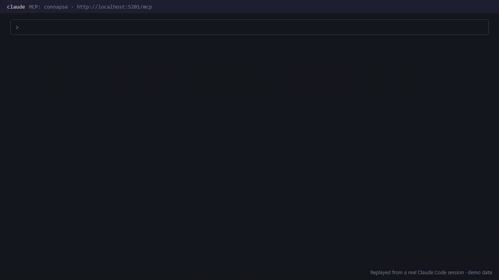
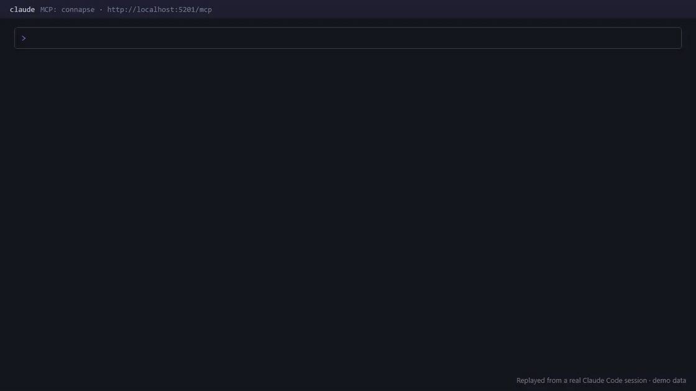
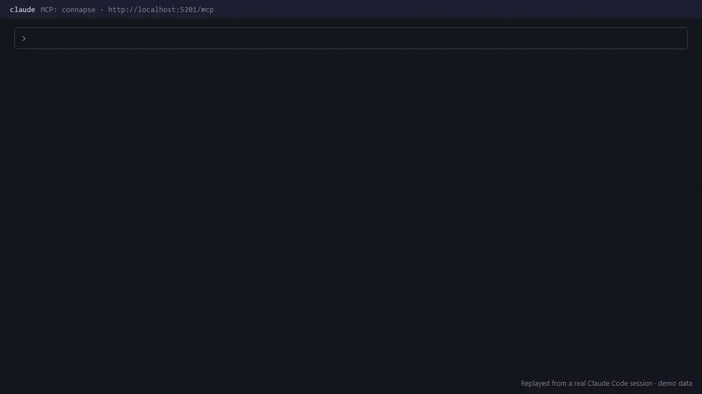
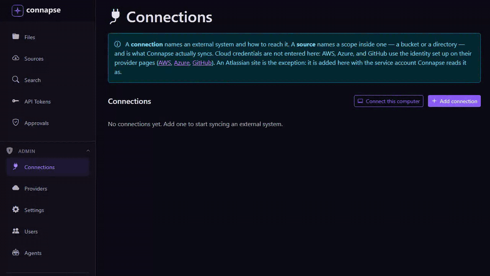
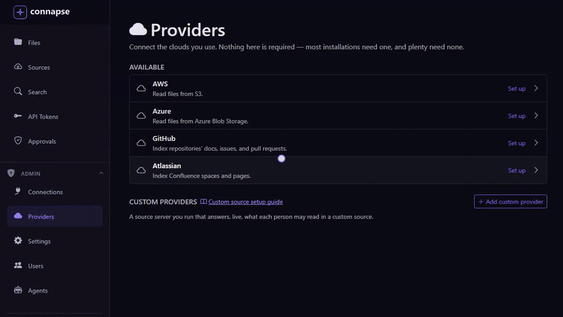
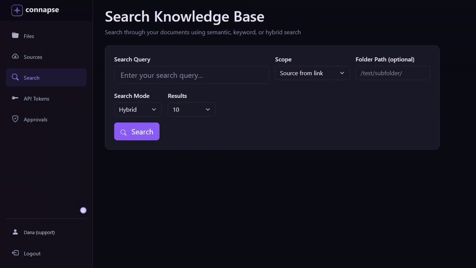
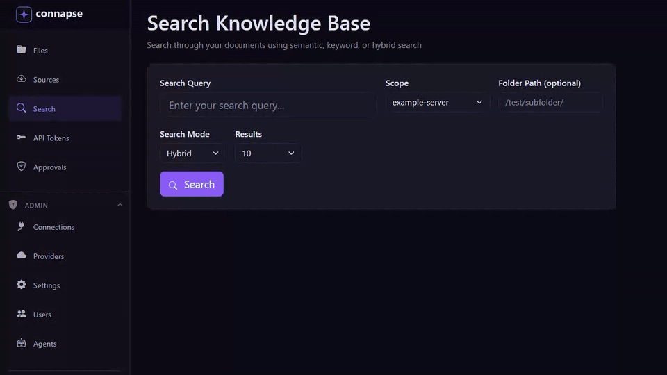
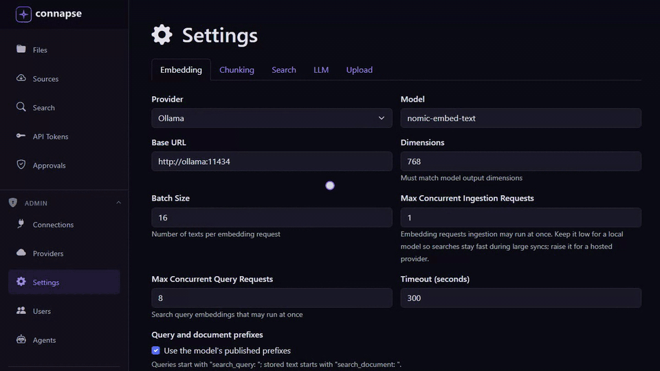

<p align="center">
  
</p>

<h1 align="center">The self-hosted knowledge base your AI agents search and remember with, over MCP</h1>

<p align="center">
  <em>Your AI agents forget everything between sessions. Connapse fixes that.</em>
</p>

<p align="center">
  <a href="https://github.com/Destrayon/Connapse/actions/workflows/ci.yml"></a>
  <a href="https://github.com/Destrayon/Connapse/actions/workflows/ci.yml"></a>
  <a href="https://github.com/Destrayon/Connapse/releases"></a>
  <a href="LICENSE"></a>
  <a href="https://glama.ai/mcp/servers/Destrayon/Connapse"></a>
</p>

<p align="center">
  
</p>

Connapse is a self-hosted knowledge base for AI agents. Point it at your files, S3 buckets, Azure Blob containers, GitHub repositories, Confluence spaces and Jira projects, and agents reach all of it through an MCP server (the Model Context Protocol, the standard way agents call outside tools) or a REST API. It is RAG with hybrid search and reranking, agent memory that keeps dated facts with their sources, and results that can be trimmed to what each person can open in the source system. It is open source, runs on your own machine with Docker, and is built on .NET 10, PostgreSQL and pgvector.

**Who it's for:** teams and developers who want Claude, Cursor, VS Code or their own agents to work from the company's documents, tickets and code, without sending that data to a hosted service.

## Quick start

You need Docker with the Compose plugin, Git, about 8 GB of free memory and port 5001 free.

```bash
git clone https://github.com/Destrayon/Connapse.git
cd Connapse
cp .env.example .env
docker compose --profile with-ollama up -d
docker compose exec ollama ollama pull nomic-embed-text
```

The first start builds the web image from source, which takes several minutes. When it is done, <http://localhost:5001> shows a setup form: create the owner account, make a container, upload a document and search it. You get passages from your document, each labelled with the file it came from. The [Quickstart](docs/get-started/quickstart.md) walks through each step.

To skip the build, the [install guide](docs/self-host/install.md) covers the prebuilt image, other embedding providers, GPUs and the optional reranker.

<p align="center">
  
</p>

## Connect an agent

In Connapse, open **Admin** → **Agents**, create an agent, and give it an API key. Then add Connapse to your MCP client. For Claude Code:

```bash
claude mcp add --transport http connapse http://localhost:5001/mcp --header "X-Api-Key: cnp_your_key"
```

[Connect an MCP client](docs/guides/mcp-clients.md) has the setup for Claude Code, Claude Desktop, VS Code and Cursor, and [Connect Claude to Connapse](docs/get-started/connect-an-agent.md) is a step-by-step tutorial.

## What your agent gets

21 named MCP tools, plus 3 generic tools that reach the rest of the REST API. Each key only gets the tools its scopes allow, and deletes over MCP can wait for your approval.

| Group | Tools | What they do |
|---|---|---|
| Search and documents | `search_knowledge`, `get_document`, `list_files`, `upload_file`, `bulk_upload`, `delete_file`, `bulk_delete` | Search a container or source, read whole documents, and add or remove files |
| Memory | `memory_remember`, `memory_recall`, `memory_correct`, `memory_timeline`, `memory_forget` | Keep dated facts with their sources, recall them in a later session, and correct them without losing history |
| Code | `code_find_symbol`, `code_references`, `code_impact`, `code_repo_map` | Find definitions and callers in indexed C#, TypeScript and Python, and see what a change could affect |
| Containers | `container_list`, `container_describe`, `container_stats`, `container_create`, `container_delete` | List, inspect, create and delete containers |

<p align="center">
  
</p>

Every tool and its parameters are in [MCP tools](docs/reference/mcp-tools.md).

## Features

### Hybrid search with reranking

Every search runs vector search and keyword search together and fuses the two rankings, so exact names and paraphrased questions both find their passages. An optional cross-encoder reranker re-scores the top results. See [About search](docs/concepts/search.md) and [Tune search](docs/guides/tune-search.md).

### Memory for agents

An agent saves what it learns as a fact: a subject, an attribute and a value, with the dates it was true and the documents it came from. A later session recalls it. A correction keeps the old value in history, and forgetting deletes every version. A fact is shown only to people who can read every source it cites. See [Agent memory](docs/reference/mcp-tools.md#agent-memory).

<p align="center">
  
</p>

### Connect your data

Upload files, or index them where they live: local folders, SFTP, Amazon S3, Azure Blob Storage, GitHub (Markdown docs, or issues and pull requests), Confluence and Jira. Anything else can connect through a custom source server you write against an open protocol. Each container has its own files, vector index and settings. See [Connect your data](docs/sources/index.md) and [file types](docs/reference/file-types.md).

<p align="center">
  
</p>

The **Providers** page lists the built-in providers next to any custom source server you add.

<p align="center">
  
</p>

### Search trimmed to what each person can open

Results from GitHub, Confluence, Jira and custom sources are checked against each reader's own access in the source system, through their linked account. S3 and Azure Blob get the same check once an admin switches on per-user permissions for that provider; until then, everyone who can search a container sees all of it. When filtering is on, a person, or an agent acting for them, never sees a passage they couldn't open in the original, and when the check can't be made the result is left out. See [Permissions](docs/concepts/permissions.md), [Amazon S3](docs/sources/aws-setup.md) and [Azure Blob Storage](docs/sources/azure-setup.md).

<p align="center">
  
</p>

### Linked results

Records point at each other, and Connapse stores those links: a GitHub issue with the pull request that closes it, a Jira issue with its epic, parent and the Confluence pages it mentions, and code with its definitions, imports and calls. With link search turned on (it is off by default), a search also brings back what its best results link to, checked against the same permissions. See [Following links](docs/concepts/search.md#following-links).

<p align="center">
  
</p>

### Run fully local with Ollama

With the Ollama profile, embeddings are computed on your machine and nothing leaves it. OpenAI or Azure OpenAI can be swapped in from **Settings** at runtime, without a restart. See [Change the embedding model](docs/guides/change-embedding-model.md).

<p align="center">
  
</p>

### Built on .NET 10, PostgreSQL and pgvector

A Blazor Server web UI, a REST API, the MCP server and the [connapse CLI](https://github.com/Destrayon/connapse-cli) all sit on one ASP.NET Core app, with PostgreSQL and pgvector for search and MinIO for uploads. See [How Connapse works](docs/concepts/how-connapse-works.md).

## Search quality

Measured with Connapse's retrieval eval on `enterprise-v1`: 50,000 documents from EnterpriseRAG-Bench and 470 questions. nDCG@10 scores how well the top 10 results are ordered, from 0 to 1.

| Configuration | nDCG@10 |
|---|---|
| Hybrid search, fusion weight 0.75, no reranker (the earlier default) | 0.565 |
| Adding the `gte-reranker-modernbert-base` reranker | 0.660 |
| Adding the reranker and today's default fusion weight, 0.65 | **0.677** |

The fusion weight sets how much the vector side counts against the keyword side. The runs are in [the fusion research note](docs/research/learned-query-fusion-2026-10-05.md#confirmed-with-the-reranker-2026-10-06), a per-slice breakdown is in [the retrieval weaknesses note](docs/research/enterprise-retrieval-weaknesses-2026-10-05.md#update--reranker-measured-2026-10-05), and the harness is in [tests/Connapse.Eval](tests/Connapse.Eval/README.md).

## Documentation

The full documentation is in [docs/](docs/index.md).

- [Get started](docs/get-started/quickstart.md): run Connapse and search your first document
- [Self-host](docs/self-host/install.md): install, production, backups, upgrades and troubleshooting
- [Connect your data](docs/sources/index.md): sources from S3, Azure, GitHub, Atlassian, folders and your own systems
- [Guides](docs/guides/mcp-clients.md): users, tokens, agents, the API and search tuning
- [Concepts](docs/concepts/how-connapse-works.md): how Connapse, search, ingestion and permissions work
- [Reference](docs/reference/rest-api.md): REST API, MCP tools, configuration, roles and scopes, file types and [error types](docs/problems.md)
- [Security policy](SECURITY.md)

## Support

- **Bugs**: [GitHub Issues](https://github.com/Destrayon/Connapse/issues)
- **Ideas and questions**: [GitHub Discussions](https://github.com/Destrayon/Connapse/discussions)
- **Security issues**: see [SECURITY.md](SECURITY.md)

## Contributing

Contributions are welcome. Start with [CONTRIBUTING.md](CONTRIBUTING.md) and [Development](docs/contributing/development.md), and look for [issues labeled `good-first-issue`](https://github.com/Destrayon/Connapse/labels/good-first-issue).

## License

[MIT](LICENSE).
