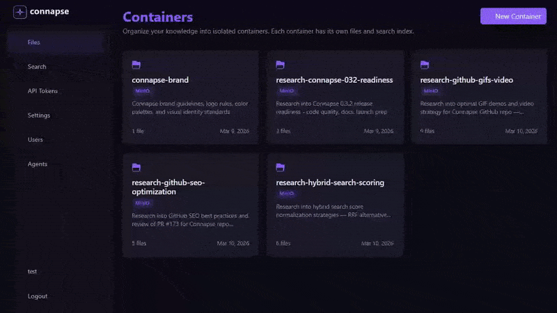
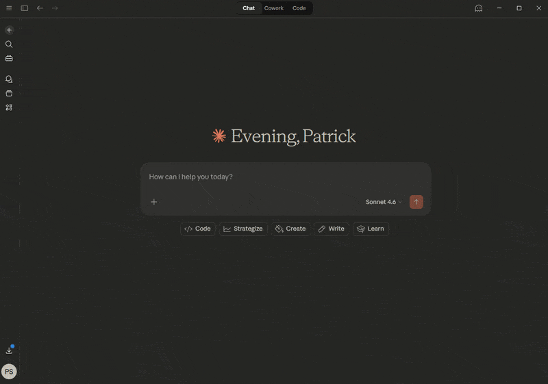
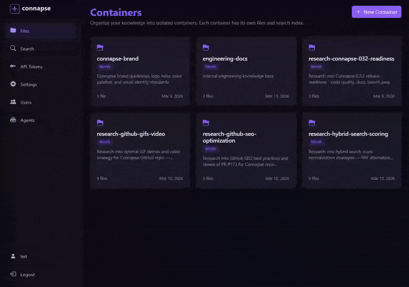

<p align="center">
  
</p>

<p align="center">
  <em>Stop losing context between AI sessions. Give your agents persistent, searchable memory.</em>
</p>

<p align="center">
  <a href="LICENSE"></a>
  <a href="https://dotnet.microsoft.com/"></a>
  <a href="https://github.com/Destrayon/Connapse/actions"></a>
  <a href="https://github.com/Destrayon/Connapse/actions"></a>
  <a href="CONTRIBUTING.md"></a>
  <a href="https://github.com/Destrayon/Connapse/issues"></a>
  <a href="https://github.com/Destrayon/Connapse/stargazers"></a>
  <a href="https://glama.ai/mcp/servers/Destrayon/Connapse"></a>
  <a href="https://github.com/Destrayon/Connapse#-quick-start"></a>
</p>

<p align="center">
  
</p>

> *Your AI agents forget everything between sessions. Connapse fixes that.*

Every time you start a new conversation, your AI agent starts from zero — no memory of past research, no access to your documents, no accumulated knowledge. Connapse is an open-source knowledge backend that gives agents persistent, searchable memory. Upload documents or point it at your existing Amazon S3 buckets or local filesystems. Agents query and build their own research corpus through the MCP server, the REST API, or the CLI. Container-isolated, hybrid search (vector + keyword), self-hosted and private. Deploy in 60 seconds with Docker. Built on .NET 10.

<details>
<summary><strong>🤖 AI Agent Integration</strong> — Claude queries and builds your knowledge base via MCP</summary>
<br>

<p align="center">
  
</p>

> *AI agents query your knowledge base through the MCP server, receiving structured answers with source citations from your documents.*

</details>

<details>
<summary><strong>🎛️ Your Knowledge, Your Rules</strong> — Runtime configuration without restarting</summary>
<br>

<p align="center">
  
</p>

> *Switch embedding providers, tune chunking parameters, and configure search — all at runtime, without restarting.*

</details>

---

## 📦 Quick Start

You need Docker with the Compose plugin and port 5001 free.

```bash
git clone https://github.com/Destrayon/Connapse.git
cd Connapse
cp .env.example .env
docker compose --profile with-ollama up -d
docker compose exec ollama ollama pull nomic-embed-text
```

Open <http://localhost:5001> and create the owner account. The full walk-through, from upload to a cited search result, is the [Quickstart](docs/get-started/quickstart.md).

## 🤖 Connect an agent

Create an agent key at **Agents** → **API Keys**, then add Connapse to your MCP client. For Claude Code:

```bash
claude mcp add --transport http connapse http://localhost:5001/mcp --header "X-Api-Key: cnp_your_key"
```

Agents get 12 named tools, such as `search_knowledge`, `upload_file` and `get_document`, plus 3 generic tools that reach the rest of the API. Other clients are in [Connect an MCP client](docs/guides/mcp-clients.md), and every tool is in [MCP tools](docs/reference/mcp-tools.md).

## 🚀 Features

- **🗂️ Containers** — Each project gets its own files, vector index and optional settings, with nothing shared between containers.
- **🔍 Hybrid search** — Vector and keyword search fused together, with optional cross-encoder reranking.
- **🧠 Your choice of models** — Ollama, OpenAI, Azure OpenAI and Anthropic, changed at runtime without a restart.
- **🔌 Index what you already have** — Uploads, local folders and SFTP, Amazon S3, Azure Blob Storage, GitHub, Confluence and Jira, and your own systems through a custom source server. Files stay where they are.
- **🔐 Per-user permissions** — Search results from AWS, Azure, GitHub, Atlassian and custom sources are trimmed to what each person can open in the source system, and fail closed.
- **🤖 Every surface** — Web UI, REST API, MCP server and the [connapse CLI](https://github.com/Destrayon/connapse-cli).
- **🐳 Self-hosted** — Docker Compose with PostgreSQL and pgvector, MinIO and optional Ollama. With Ollama, nothing leaves your machine.

## 📚 Documentation

The full documentation is in [docs/](docs/index.md).

- [Get started](docs/get-started/quickstart.md) — run Connapse and search your first document
- [Self-host](docs/self-host/install.md) — install, production, backups, upgrades and troubleshooting
- [Connect your data](docs/sources/index.md) — sources from S3, Azure, GitHub, Atlassian, folders and your own systems
- [Guides](docs/guides/mcp-clients.md) — users, tokens, agents, the API and search tuning
- [Concepts](docs/concepts/how-connapse-works.md) — how Connapse, search, ingestion and permissions work
- [Reference](docs/reference/rest-api.md) — REST API, MCP tools, configuration, roles and scopes, file types and [error types](docs/problems.md)
- [Security policy](SECURITY.md)

## 💬 Support

- 🐛 **Bugs**: [GitHub Issues](https://github.com/Destrayon/Connapse/issues)
- 💡 **Ideas and questions**: [GitHub Discussions](https://github.com/Destrayon/Connapse/discussions)
- 🔒 **Security issues**: see [SECURITY.md](SECURITY.md)

## 🤝 Contributing

Contributions are welcome. Start with [CONTRIBUTING.md](CONTRIBUTING.md) and [Development](docs/contributing/development.md), and look for [issues labeled `good-first-issue`](https://github.com/Destrayon/Connapse/labels/good-first-issue).

## 📄 License

[MIT](LICENSE).
