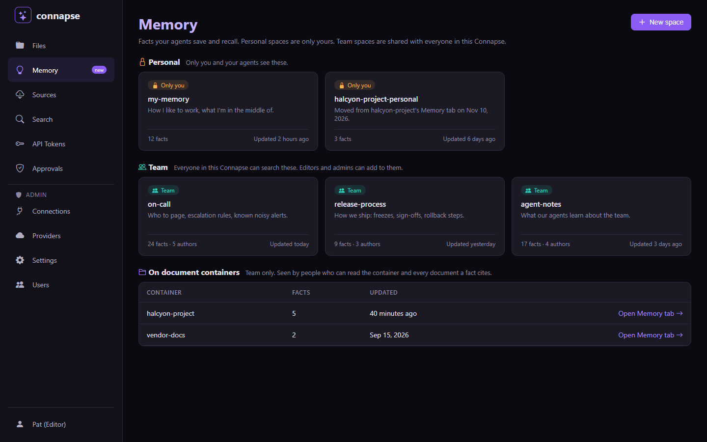
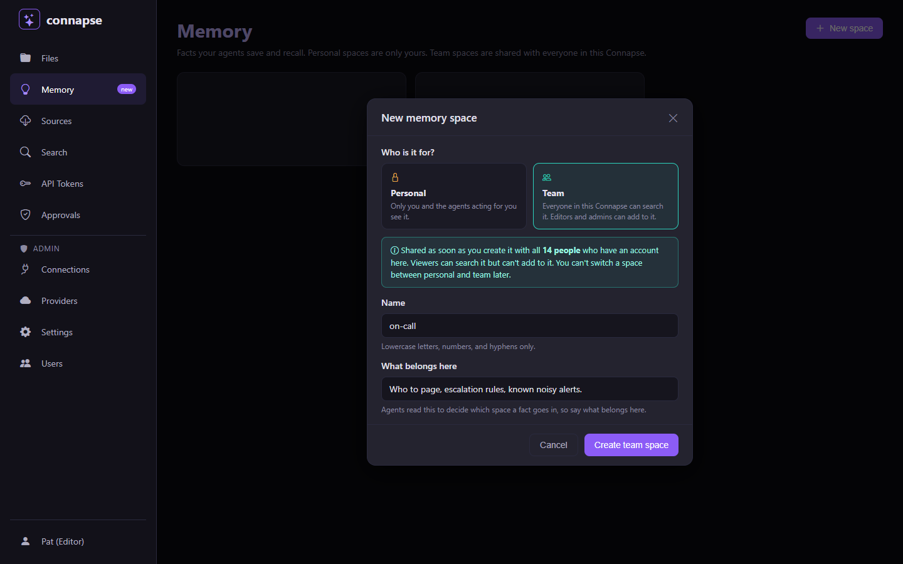
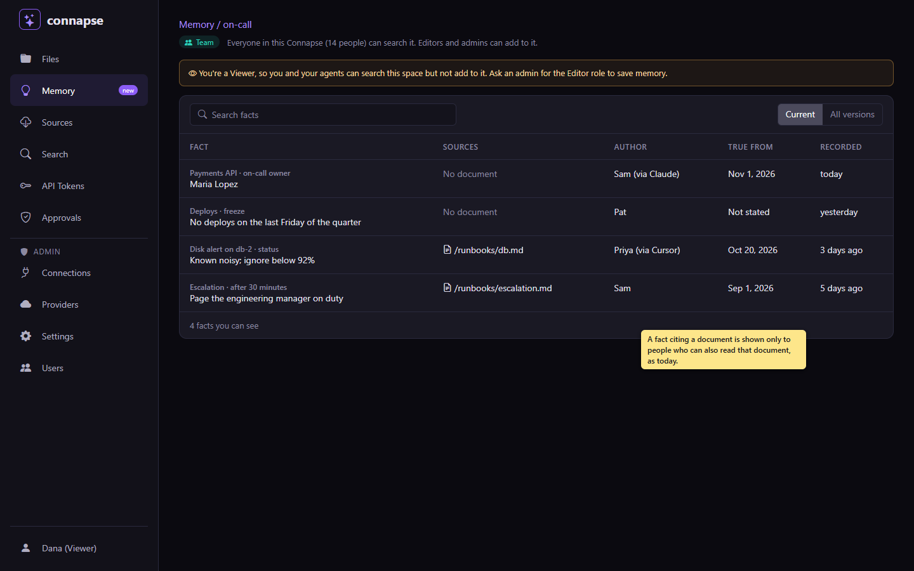
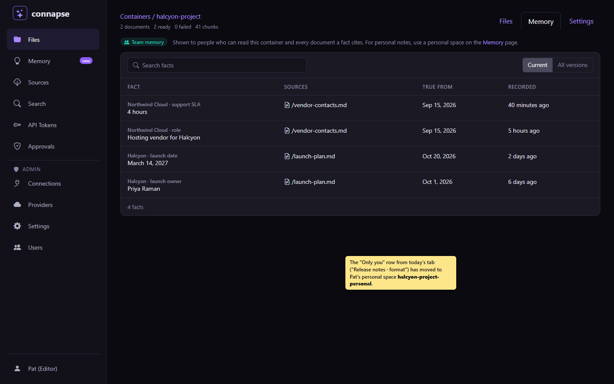
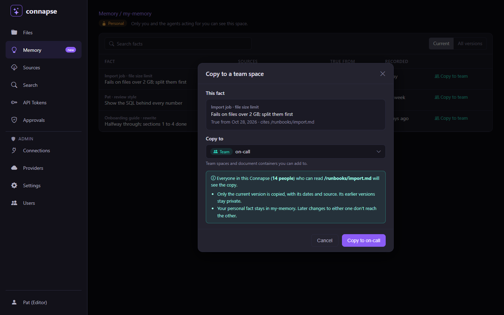
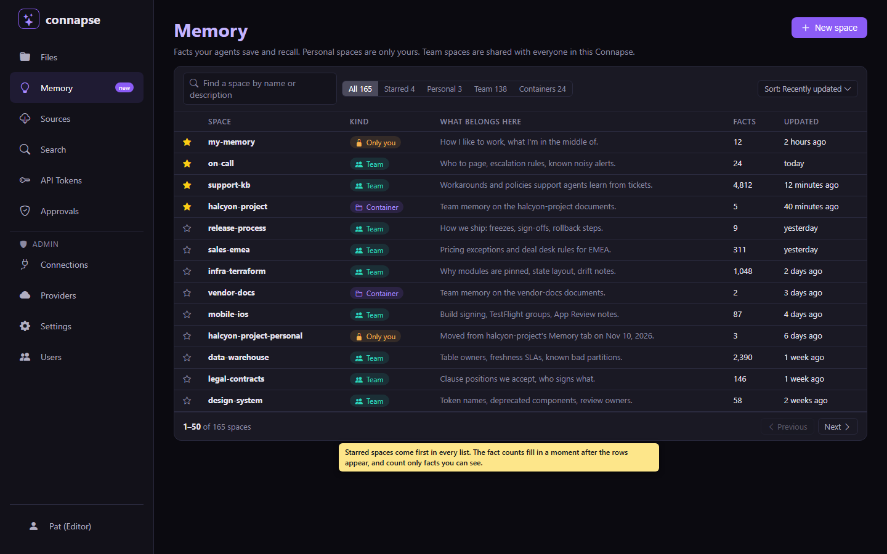
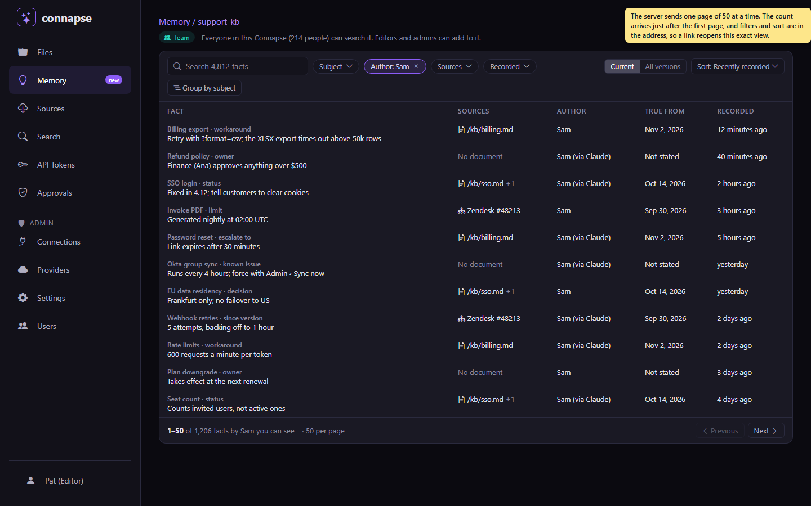
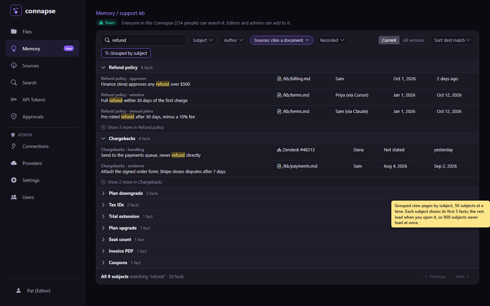
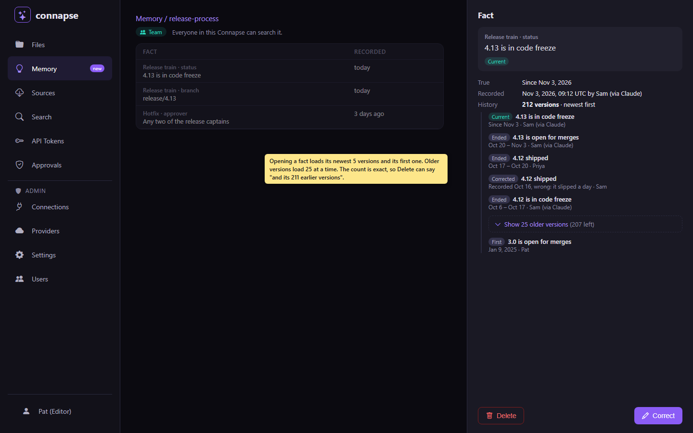

# Plan: memory spaces on a Memory page (CON-238)

**Status:** plan only, nothing built. Replaces [con-233-personal-team-memory.md](con-233-personal-team-memory.md).
Research: [memory-spaces-2026-11-03.md](../research/memory-spaces-2026-11-03.md), building on
[personal-team-memory-2026-11-02.md](../research/personal-team-memory-2026-11-02.md).
Plain-words version: [con-238-memory-spaces-explained.md](con-238-memory-spaces-explained.md).

## What changed from CON-233, and why

CON-233 kept all memory inside containers and let each fact be personal or team. The user decided against that:
"I'd prefer if memory was a tab in the nav rather than tied to containers", and "only container level memory can
be tied to containers, which are team only, but for regular team and personal memories, you create memory
'containers' in the memory tab."

So the choice moves from each fact to the place it is saved. You make **memory spaces** on a new **Memory** page in
the nav, and each space is personal or team. A document container can still hold memory, but only team memory.
An agent no longer picks a scope for each fact; it picks a space, and the space says who will see it.

These points from the user still stand: read-only users can't save memory, because saving costs compute, but they
can search team memory; personal and team must be obvious to agents; and memory is managed in one way, not three.

## The three kinds of place memory lives

| | Personal space | Team space | Memory on a document container |
|---|---|---|---|
| Made where | Memory page, **New space** → Personal | Memory page, **New space** → Team | Comes with every document container |
| Who sees it exists | Only its owner | Everyone with an account | Everyone with an account, as today |
| Who can search it | Its owner and the agents acting for them | Everyone with an account, Viewers included | Everyone with an account, Viewers included |
| Who can add, correct or forget | Its owner, while they have write access | Editors, Admins and Owners | Editors, Admins and Owners |
| Every fact is | Personal | Team | Team |
| Fact trimming | A fact citing documents is still shown only to people who can read all of them (the rule since 2026-10-27) | Same | Same |

"Write access" is the Editor role or above plus a token with `knowledge:write`, as PR #1123 already enforces.

**Personal or team is fixed when the space is made.** Products split here. Microsoft Loop and Confluence keep
personal and shared spaces as different kinds that can't be converted (Loop's "My workspace" can't be shared at
all), while ChatGPT, Claude, Notion and Basic Memory widen a project or page later by sharing it. Fixed is the
better fit for Connapse: a space's audience is what tells an agent who will read a fact, so it shouldn't change
under facts already saved for a different audience. A personal fact that should be shared is copied into a team
space with the **Copy to team** button (below), or an agent saves it again there. This removes the per-fact "Share
with team" and "Make personal" actions CON-233 planned, and the hard cases they had (mixed-author chains, legacy
versions).

**Every Editor gets a personal space called `my-memory`**, made the first time they open the Memory page or an
agent saves personal memory for them. This is Loop's "My workspace" and Notion's Private section: there is always
somewhere personal to save, so an agent never has to stop and ask the user to create one. People can make more.
Viewers get none, since they can't save. Someone demoted to Viewer keeps reading their own personal spaces.

**A team space is shared with everyone the moment it is made.** Connapse has no per-container permissions (roles
apply to every container, `docs/concepts/permissions.md`), so a team space follows the same rule: every account can
search it, and the role decides who can add. There is no invite step. The create dialog says this in words, with the
number of people. The user decided on 2026-11-03 that team spaces stay visible to every account: there are no
team spaces limited to named members.

**Memory on a document container is team only.** It stays in the container's Memory tab (CON-225), labelled "Team
memory", and the Memory page lists every container that has some. It is for facts learned from that container's
documents. Saving personal memory there is refused, with an error that names the caller's personal spaces.

## Pictures

The Memory page, as Pat (an Editor) sees it. Personal spaces, team spaces and document containers with memory are
three labelled sections, like Notion's Private and Teamspaces sections.

Making a space. The audience is the first question, and the note spells out who will see a team space.

A team space as Dana, a Viewer: she can search it but not add, and a fact citing a document is still shown only to
people who can read that document.

A document container's Memory tab after the move: team facts only, with a pointer to personal spaces.

Copying a personal fact to a team space. The note says who will see the copy, that only the current version goes,
and that the personal fact stays.

## Who can do what on the Memory page

- **Create a space:** Editors and above. Viewers see team spaces and container memory but no **New space** button.
- **Rename, edit the description, delete:** a personal space by its owner; a team space by Editors and above, the
  same people who can delete a container. Deleting a team space names how many facts and authors go with it.
- **Admins can't open someone else's personal space.** They don't see that it exists, as with personal facts today.
  When an account is deleted, its personal spaces are deleted with it.
- **The description matters:** the dialog asks "What belongs here" and says agents read it to choose a space.

## Copying a personal fact to a team space

The user asked for a **Copy to team** button on 2026-11-03. It sits on each current fact in a personal space's
view (the picture above) and opens a dialog that names the destination and who will see the copy.

- **Who can use it:** the space's owner, while they have write access. Viewers, including a demoted Editor reading
  their old personal spaces, see no button. The destination list holds only team spaces and document containers
  the caller can add to. The facts in a mixed chain left on a document container (see the migration) have no button,
  since they aren't in a personal space.
- **What is copied:** the current version only, as a new fact with a new id in the destination: its subject,
  attribute, value, the dates it was true, its reason and its citations. Earlier and corrected versions are not
  copied, because they may hold notes the owner never meant to share, and the team fact's history starts at the
  copy. The copier is its author.
- **Citations are checked as for any save:** the copier must still be able to read every cited document, or the copy
  is refused and the dialog names the document. After the copy, the trimming rule still applies, so a teammate who
  can't read a cited document doesn't see the copy, and the dialog names those documents.
- **The personal original stays put,** unchanged and still personal. The two are not linked: correcting or
  forgetting one leaves the other alone, and the team fact shows nothing of the personal one.
- **A fact already in the destination:** if the destination has a current fact with the same subject and
  attribute, the dialog shows it and the button reads "Copy anyway"; it does not overwrite or correct it.
- **Agents don't need it.** An agent shares a fact by calling `memory_remember` with a team `space`, so there is no
  new MCP tool. The button calls a REST endpoint, `POST /api/memory/facts/{id}/copy` with the destination, which
  reads the current version and saves it through CON-235's normal save path. The audit log records the copy by
  both fact ids, never the content.

## How agents choose where to save and where to search

Models misjudge what is private in a quarter to half of cases (ConfAIde, PrivacyLens), so the choice is explicit,
named in plain words and checked by a person after the fact, as in CON-233. What changes is that the agent chooses
a space, and a space has one audience.

1. **A new read-only tool, `memory_spaces`,** lists the spaces the caller can see: name, id, kind (`personal`,
   `team` or `container`), description, whether the caller can add to it, and who sees it in words ("only you",
   "everyone in this Connapse, 14 people"). Agents call it once per session, as Claude Code reads `CLAUDE.md` once.
2. **`memory_remember` takes a required `space`**, a space or container name or id. Basic Memory's MCP server works
   the same way: every tool takes a `project`, and a call that doesn't name one is refused when several exist. The old `containerId` parameter
   keeps working as an alias for one release. There is no `scope` parameter: the space decides it, which replaces
   the required `scope` CON-233 planned. The description gives the test GitHub Copilot uses: "Save to a personal
   space if it is about the user, their preferences or their own work; to a team space if it would be true and
   useful for others; to a document container if you learned it from that container's documents. If unsure, ask."
3. **The answer says who will see the fact**, as CON-233 planned: "Saved to *on-call*, a team space: everyone in
   this Connapse can see it" or "Saved to *my-memory*: only you see it." Agents relay this, so a wrong choice is
   caught at once.
4. **`memory_recall` and `memory_timeline` take an optional `space`.** Left out, they search every space and
   container the caller can see, and each fact comes back labelled with its space and `personal` or `team`. When a
   personal and a team fact disagree, both come back and the description says the team fact is the shared record
   and the personal one is this user's own note. Viewers' agents can recall; they just can't save.
5. **`memory_correct` and `memory_forget`** find the fact by id, so `space` is optional there. Today both require
   `containerId` and the store only looks in that container, so a fact moved by the migration would come back "not
   found" under its old container. From CON-236, the ticket that moves facts, they look the fact up by id across
   every space and container the caller can see; a `containerId` or `space` that is passed is ignored for the
   lookup, so an agent holding the old container id still reaches a moved fact. A fact the caller can't see is still
   "not found". A correction stays in the fact's space, keeps its scope and, when `sources` is left out, its sources
   (PR #1123).
6. **`search_knowledge` and `container_list`** never show another user's personal space. Asking for one by id or
   name gets the same "not found" as a space that doesn't exist, so nobody can probe for one.

A name used by both one of your personal spaces and a team space or container is refused as ambiguous, with both
ids, because personal space names are only unique per owner. Using the id always works.

## How today's memory moves over, with nobody gaining or losing access

PR #1123's migration has already given every fact version a scope that matches who could see it: versions citing
sources are team, versions citing nothing are personal. This plan's migration moves facts between places and never
changes a version's scope, so the visibility rule (every source readable, and team or yours) gives every reader the
same answer before and after.

- **Team facts on document containers** stay where they are.
- **Personal facts on document containers** move, whole chain at a time, to a personal space for their author named
  after the container, such as `halcyon-project-personal`, with the description "Moved from halcyon-project's
  Memory tab on <date>". A fact written by an agent with no user moves to a space owned by that agent.
- **Agent memory containers (CON-227)** become team spaces with the same id, name and description, so agents and
  tokens that name them keep working. Their personal facts move out to the author's personal space the same way.
  Their team facts stay. The Create Container dialog loses its "Agent memory" type; spaces are made on the Memory
  page.
- **A chain that mixes personal and team versions** (only possible from before the scope column, when one person
  corrected another's fact without sources) can't move without splitting its history. It stays where it is, and
  it is the one exception to "container memory is team only": each version keeps its scope in current reads,
  history and the Memory tab, its personal versions show only to their author with an "Only you" label, and a
  correction keeps the scope of the version it replaces (PR #1123's rule), not the container's. Its current version
  can be personal: PR #1123's `MemoryScopeMigrationTests` seeds a personal, then team, then personal chain, and that
  chain is part of this migration's test. The migration logs how many there are; we expect very few.
- **Container ids and fact ids don't change.** Only a moved fact's container id changes. An agent that recalls from
  `halcyon-project` by name no longer gets its old personal notes there, but a recall without `space` finds them.

The done-condition is a test that seeds every case above, runs the migration, and compares every reader's view of
every fact before and after, extending PR #1123's `MemoryScopeMigrationTests`.

## What changes in open PR #1123 (CON-234)

Most of it is reused as it is:

- **Keep:** the `scope` column and `AddMemoryScope` migration; the visibility rule; write access for remember,
  correct and forget whatever the scope; read-only users and keys recalling team facts; corrections keeping the
  old scope and inheriting omitted sources; refusing a team correction that drops a source; and the tests for all of
  these. Spaces build on exactly this: a space just decides which scope new facts get.
- **Remove:** the `memory.setScope` operation, its sole-author check and their tests. A fact's scope no longer
  changes after it is saved; to share, copy it or save it again in a team space. Nothing uses it yet, so nothing
  breaks.
- **Remove:** the PR's edits to `docs/plans/con-233-personal-team-memory.md`, which this plan supersedes. Its
  progress notes belong in this plan's Progress section once it merges.
- **Update the PR body:** drop the references to a Mine / Team / All filter in a container's Memory tab (CON-236 as
  planned before). The memory-scope pictures stay valid for what the PR does.
- **Unchanged until CON-235:** when `scope` is left out, sources still decide it, as the PR does now.

## Old-style saves never widen a fact

Agents already call `memory_remember` with `containerId` and no scope, and under PR #1123 a call that cites no
sources saves a personal fact. Once spaces decide scope, the same call on a document container or a former agent
memory container would save a team fact that every account can read. Tool descriptions changed later can't protect
clients that are already running, so from CON-235 on, and for as long as the `containerId` alias lasts:

- A save that names a place with `containerId` (not `space`) and cites no sources is saved as personal, in the
  caller's `<container>-personal` space (made if missing, the same space the migration uses), and the answer says
  where it went. A sourced save stays a team fact on the container, as it is today.
- Saving a team fact with no sources needs the new `space` parameter naming a team space or container, so sharing
  is always an explicit choice.

CON-235's tests send PR #1123's old sourceless requests to a document container and an agent memory container and
check the facts stay visible only to their author.

## Scaling: hundreds of spaces, tens of thousands of facts, long histories

The Memory page has to stay quick and usable when a team has hundreds of spaces, one space holds tens of thousands
of facts, and one fact has been corrected hundreds of times. The database already copes; today's app does not.
Research on how Notion, Linear, Obsidian, mem0, Zep and Letta handle big lists is in
[`docs/research/memory-large-lists-2026-11-03.md`](../research/memory-large-lists-2026-11-03.md).

### What today's Memory tab does, and where it breaks

Today's tab (CON-225, `MemoryTab.razor`) asks for one batch of at most 100 facts and shows "the first 100. Search to
narrow them down." It has a full-text search box and a Current / All versions switch, and nothing else: no next
page, no total, no sort, no subject or author filter. A fact's history is also capped at its newest 100 versions,
and the delete prompt counts versions from that capped list.

Behind it, `MemoryService.RecallAsync` reads 200 rows at a time with offset paging and then drops, in the app, every
fact the caller may not see (a personal fact by someone else, or a fact citing a document the caller can't read). It
keeps reading until it has enough. When the caller can see only a few facts in a big space, it reads the whole space
and checks document permissions page by page before it can show anything.

We measured the database on a Postgres container capped at 2 CPUs and 4 GB, seeded with 104,706 fact versions: one
space with 50,000 current facts, one with 10,000, 40 spaces of 500, a third of facts corrected at least once, one
fact with 500 versions, and 70% of facts citing a document.

| Query | Today's indexes | With the two indexes below |
|---|---|---|
| First 200 current facts, 50k space | 11.9 ms | 0.24 ms |
| A page 40,000 rows in (offset today, keyset with the index) | 37 ms, sorting on disk | 0.28 ms |
| Exact count of current facts | 13.8 ms | 4.4 ms |
| Ranked full-text search, first 200 | 1.5 ms | (unchanged) |
| Subjects with counts, first 50 | 1.3 ms | (unchanged) |
| Newest 100 versions of the 500-version fact | 0.31 ms | 0.23 ms |
| Every current fact plus its sources (the "sees almost nothing" case) | 45.7 ms, plus permission checks in the app | not needed (below) |

So the limits are the 100-row cap with no paging, the filter that runs in the app instead of in SQL, and offset paging
deep in a list. "Keyset paging" fixes the last one: instead of "skip 40,000 rows", the next page asks for "rows after
the last one I showed", which an index answers directly however deep you are.

### Many spaces (the Memory page)

- **Find and filter.** A "Find a space" box matches name and description. Filters across the top show a count each:
  All, Starred, Personal, Team, Containers.
- **Sort.** Recently updated (the default), Name, or Most facts.
- **Starred spaces first.** Anyone can star a space for themselves, as Notion and Linear favourites work, and starred
  spaces stay at the top of every list and filter. The personal `my-memory` space is starred for you at the start.
- **Cards, then a table.** Up to nine spaces show as the cards in the first picture. Past that the page switches to
  the compact table above, 50 rows a page, with "1–50 of 165 spaces" and Previous / Next. Space lists are small
  enough that an exact total is cheap.
- **Counts load late.** The rows appear first. Each row's fact count and "Updated" time then fill in from one grouped
  query over just the spaces on screen.

### Many facts in one space

- **Paging on the server.** A space shows 50 facts a page with Previous / Next and "1–50 of 4,812 facts you can see".
  Each page is one keyset query, so page 90 costs the same as page 1. We don't use virtual scrolling (a long list
  that draws only the rows in view), because it needs the exact total and a jump to any row up front, and both cost a
  full count for every viewer, since what each person can see differs.
- **The visibility filter moves into SQL.** Before each list, the server works out once which of the space's cited
  documents this caller can read, using the per-user permission cache, and passes that set into the query. The query
  then returns only facts the caller can see: their own or team facts whose every cited document is in the set. This
  removes the read-and-drop loop, and a viewer who sees 1% of a space waits no longer than one who sees all of it.
- **Counts never reveal hidden facts.** The total counts only facts the caller can see, using the same readable set.
  It loads after the first page. If it takes longer than 2 seconds it stops and shows "4,000+".
- **Search.** The ranked full-text search stays. Its results page the same way, up to the best 1,000 matches.
- **Filters.** Subject (type ahead, with counts), Author, Sources (cites a document, or none), Recorded between two
  dates, and Current / All versions. Filters combine.
- **Sort.** Recently recorded (the default), Subject A–Z, True from, and Best match while searching.
- **Group by subject.** An optional view that shows each subject as a heading with its count, 50 subjects a page.
  A subject shows its first three facts and loads the rest when opened.
- **The address keeps the view.** Search, filters, sort and page live in the page address, so a link or Back reopens
  the same view.
- **Only what's on screen loads.** Source titles load for the rows shown, a fact's history when it's opened, and the
  count after the first page.

### Long histories

Opening a fact shows its exact version count, its newest five versions and its first. "Show 25 older versions" loads
the next 25 with a keyset query on the chain index, as Linear collapses older activity on an issue. The 100-version
cap goes, and the delete prompt gets its number from a count query, not from the loaded list.

### API and database

Every list endpoint returns `items` and an opaque `nextCursor` (the last row's sort value and id, plus a fingerprint
of the space, filters and sort, encoded), and none returns a total; totals come from their own endpoint so the first
page never waits on them. This is the shape Notion, Zep and Letta use. A `cursor` whose fingerprint doesn't match the
request's space, filters or sort gets a 400, so a page never mixes two different views; CON-235 tests reusing a
cursor after changing `sort` and after changing `author`.

| Endpoint | Parameters | Returns |
|---|---|---|
| `GET /api/memory/spaces` | `cursor`, `limit` (default 50, max 100), `kind`, `q`, `starred`, `sort` | spaces, `nextCursor`, and a total (space lists are small) |
| `GET /api/memory/spaces/{id}/facts` | `cursor`, `limit` (default 50, max 100), `q`, `subject`, `author`, `cites`, `from`, `to`, `status`, `sort` | facts, `nextCursor` |
| `GET /api/memory/spaces/{id}/facts/count` | the same filters | `{ count, capped }` |
| `GET /api/memory/spaces/{id}/subjects` | `cursor`, `limit`, `q` | subjects with counts, `nextCursor` |
| `GET /api/memory/facts/{id}/history` | `cursor`, `limit` (default 25) | versions, `nextCursor`, `total` |

MCP follows: `memory_recall` and `memory_timeline` return a `nextCursor` an agent can pass back, and `memory_spaces`
returns at most 100 spaces with a name filter.

Two indexes, both measured above:

- `(container_id, recorded_at DESC, id) WHERE superseded_at IS NULL`, a partial index over current facts only, for
  the default list, its keyset pages and the count.
- `(chain_id, recorded_at DESC, id)`, replacing today's `idx_memory_facts_chain`, for history pages.

The existing `(container_id, subject, attribute)` index already serves the subject filter and the grouped view, and
the full-text index serves search. The CON-236 migration moves facts in batches of about 1,000 chains, so a 50,000-fact
container never sits in one long transaction.

### Targets and the load test

Targets are server time on Postgres capped at 2 CPUs and 4 GB, with 50,000 current facts (about 65,000 versions) in
one team space, 200 spaces in all, a 500-version fact, and a viewer who can read only 1% of the cited documents. Each
is the 95th percentile over 20 runs.

| Operation | Target |
|---|---|
| First page of a space, any filter or sort | under 150 ms |
| Any later page | under 150 ms |
| Search, first page | under 300 ms |
| Visible count | under 2 s, or shown as capped |
| Memory page list with 200 spaces, counts included | under 300 ms |
| First history page of the 500-version fact | under 100 ms |

The load test seeds exactly that data, runs each operation as both a full reader and the 1% viewer, and fails if a
target is missed. It is tagged `[Trait("Category", "Load")]` so the normal test run skips it; it runs before a
ticket's PR merges and its numbers go in the PR body.

## Revised build tickets, in order

One ticket per PR. Each needs the one before it merged.

1. **CON-234: scope in storage and rules (PR #1123).** As above, minus `memory.setScope`. Done when the PR's tests
   pass with the removal and it merges.
2. **CON-235: memory spaces in storage and REST.** Add audience (`personal` or `team`) and owner to memory
   containers; personal space names unique per owner; `my-memory` made on first use; REST endpoints to list,
   create, rename and delete spaces; new facts take their scope from the space (personal space: personal; team space
   or document container: team); personal saves on a document container refused; old-style `containerId` saves
   without sources kept personal (the section above); personal spaces hidden from
   every other caller in container lists, lookups by id and name, search and the admin pages. It also carries the
   storage half of the Scaling section: the two indexes, the visibility filter moved into SQL with the readable set,
   the paged spaces, facts, count, subjects and history endpoints with their filters and sorts, and stars. Done when
   tests show a non-owner gets "not found" for a personal space by id and by name on every surface, a Viewer can
   recall from a team space but not save to it, paging through a space returns every visible fact exactly once and no
   hidden one, the count never includes a fact the caller can't see, and the load test at 50,000 facts and 200 spaces
   meets every target in the Scaling section, with its numbers in the PR body.
3. **CON-236: move today's memory into spaces.** The migration in the section above. Done when the before-and-after
   test shows every reader sees exactly the same facts, including a mixed chain whose current version is
   personal, and agent memory containers open as team spaces with their old ids. It also makes `memory_correct`
   and `memory_forget` find a fact by id across visible spaces, with `containerId` optional and not used to
   filter, and tests that a moved fact can be corrected and forgotten by its old container id. The migration moves
   facts in batches of about 1,000 chains; it is also done when it moves a 50,000-fact container in under 2 minutes
   on the load test's 2-CPU, 4 GB Postgres.
4. **CON-237: MCP tools and docs.** `memory_spaces`; required `space` on remember (with the `containerId` alias);
   optional `space` and labels on recall and timeline; the plain-words answers; tool descriptions;
   `docs/reference/mcp-tools.md`, `docs/problems.md`, and a rewrite of `docs/concepts/memory.md` around spaces (it
   still says memory has no web page). `memory_recall` and `memory_timeline` return a `nextCursor`, and
   `memory_spaces` returns at most 100 spaces with a name filter. Done when an agent that leaves out `space` gets an
   error that lists its spaces, an agent can page through a 50,000-fact space by passing the cursor back, and the
   concept page matches the tools.
5. **New ticket: the Memory page.** The nav entry, the page, the New space dialog, a space's view (the CON-225
   fact table, with an Author column for team spaces and the Viewer notice), the "Team memory" label and pointer on
   a container's Memory tab, and removing the "Agent memory" type from the Create Container dialog. It also carries
   the **Copy to team** button and its REST endpoint, which needs no storage change. It also carries the page half
   of the Scaling section: find, filters, sort, stars and the paged table on the Memory page; paging, filters, sort,
   group by subject, the late-loading count and the view kept in the address on a space; and paged history. One
   shared paged fact list serves both a space and a container's Memory tab, replacing today's 100-row table. Done
   when the pages match the pictures above for an Editor and a Viewer, a browser test against the load test's 50,000
   facts shows the first page within 1 second and page 2 and a search within 1 second each, and tests show a copy keeps
   only the current version and its citations, leaves the personal fact unchanged, is refused for a Viewer or a
   non-owner, and is not shown to a teammate who can't read a cited document.

CON-235 is the largest. If it passes the PR size limit, it splits into storage and rules first, then REST, and the
split goes to the PM before coding.

## Progress

- **CON-238, 2026-11-03.** This plan, its explainer, the research report and four mockup pictures in
  `docs/images/memory-spaces/`. No product code. Next: CON-234 (PR #1123) drops `memory.setScope` and merges.
- **CON-238 rework, 2026-11-03.** The user answered both open questions: team spaces stay visible to every account,
  and a Copy to team button is added (its own section, the Memory page ticket, a fifth picture). Docs only.
- **CON-238 scaling rework, 2026-11-03.** Measured today's queries at 50,000 facts, added the Scaling section with
  targets and a load test, a research report on large lists, four more pictures, and folded the work into CON-235,
  CON-236, CON-237 and the Memory page ticket. Docs only. Next: unchanged, CON-234 (PR #1123) merges.
- **CON-236, 2026-11-04.** Migration `MoveMemoryIntoSpaces` moves each all-personal, single-author chain on a team
  container into its author's `<container>-personal` space in committed batches of 1,000; team and mixed chains stay.
  Correct and forget now find a fact by id anywhere, so old container ids still work. Verified: before/after views for
  six readers are identical, and 50,000 facts move in 1.1 s on a 2 CPU / 4 GB database. Next: CON-237.
