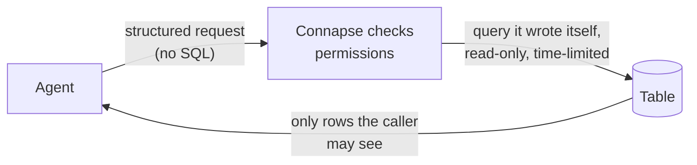

# The tables container, in two minutes

The short version of the [CON-E6 plan](con-e6-tables-container.md). Nothing here is built yet; this is the plan
waiting for approval.

## What it is
Today every Connapse container holds documents, which get cut into text passages for search. A **tables container**
is a second kind of container. Each spreadsheet or CSV file put into it becomes a real database table with typed
columns (numbers stay numbers, dates stay dates), instead of being turned into text.

## Why text search isn't enough for tables
Text search finds passages that sound like the question. It can't count, add up or compare rows. Ask "how many orders
shipped late in March" and it returns a few chunks of the spreadsheet; the agent then has to guess from whatever rows
happened to come back. In a published benchmark (TAG), text search answered **0%** of table questions, while querying
the data directly answered **17–55%**.

We'll prove it on our own data before shipping. The test set has 180 held-out questions over 8–12 real and generated
tables, with every correct answer computed by a database query, not by hand. The tables container ships only if it
gets at least **70%** right, beats text search by at least **25 points** (and the gap is statistically solid), is no
worse on any type of question, causes no drop in normal document search, and leaks nothing in the permission tests.
These bars are fixed now, before any results exist.

## How an agent uses it
The agent never writes database code. It gets four tools: **list** tables, **describe** one (its columns and three
sample rows), **read** rows with a filter, and **aggregate** (count, sum, average, minimum, maximum, grouped). It sends
a structured request such as "table orders, where shipped late is true, group by region, count". Connapse checks every
table and column against what that person may see, then writes the query itself.

Safety comes in layers, each enough on its own: the agent can only send that request shape; the database login used
for these queries can read table data and nothing else; every query is read-only with a 5-second limit and a cap on
answer size; and if Connapse can't confirm someone's access, it shows nothing rather than everything. The reference
Postgres connector for agents let the model write its own SQL, and a single `COMMIT;` broke it out of its read-only
mode, which is why we don't.

## How it ties to normal documents
Tables inside PDFs and Word files stay searchable as text. When one is clean enough (one header row, consistent
columns), it is also turned into a real table, and the passage it came from gets a pointer to it. A search hit then
says "this passage has a table; query it with these tools", so the agent counts rows instead of reading numbers out of
text. The pointer only appears if the person may see that table.

Agent memory moves onto the same layer: each container's memory shows up as a built-in table the same tools can query.
Its data isn't copied, and memory's own tools keep working as they do today.

## What gets built, in order
1. **Test set and pass bar, then a text-search baseline run** — so the bar exists before any table code.
2. **The container type, storage, CSV loading, the safe query layer, permission trimming, the four tools, and change
   history for re-synced files** (seven tickets).
3. **The proof run.** Nothing ships unless it passes.
4. **After the proof:** Excel loading, moving memory onto the layer, finding the right table by description,
   admin-saved queries, and document tables with passage pointers. The last three can slip past v0.5.0 if time runs
   short.

Fifteen tickets in all, one pull request each.

## Out of scope
- Agents writing their own SQL, or any tool that changes table data.
- Joining tables across containers.
- Nested JSON, and OpenDocument spreadsheets (ODS).
- Copying memory's data into new tables.
