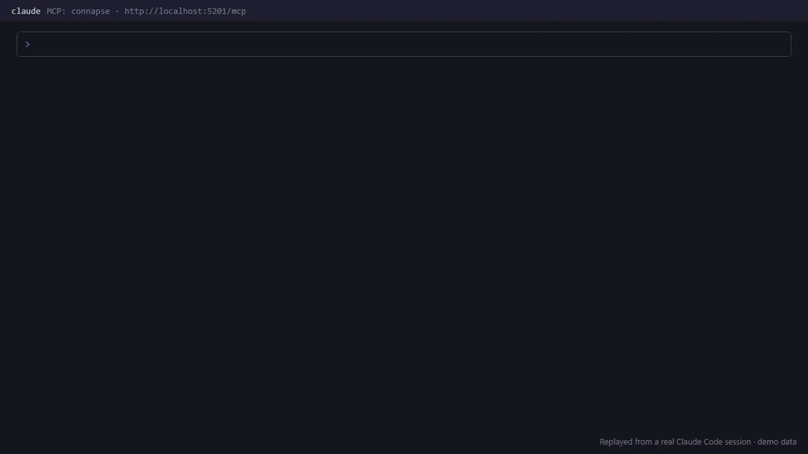

<!--
Draft of the GitHub release notes for v0.4.0. Paste everything below this comment into the
release body when you publish. Before publishing: set the release date in CHANGELOG.md. The GIF
loads from the v0.4.0 tag, so it shows once that tag exists.
-->

# Connapse v0.4.0

<p align="center">
  
</p>

**Your agents can now search GitHub, Jira, Confluence, S3, Azure Blob and SFTP, remember what they learn, and read code.**

## What's new

- **Agent memory.** Six MCP tools let an agent store dated facts with their sources, correct them without losing the history, and recall them in a later session. Each fact goes into a memory space the agent names: a personal space only you and your agents see, or a team space everyone sees. The **Memory** page shows every space's facts and their history.
- **One command to start.** `docker compose -f oci://ghcr.io/destrayon/connapse:compose up -d -y` gives a working server with search ready, with nothing to clone, no file to edit and no default passwords. Whole folders upload from the browser, subfolders included.
- **Linked results.** Turn on link search and a search also returns what its best results point to: the issue a pull request closes, the epic above a Jira issue, the Confluence page an issue links.
- **Code tools.** C#, TypeScript and Python files are split at each definition. Four MCP tools find a symbol, its references, what a change would affect, and a map of the repository.
- **Your tools, your permissions.** GitHub, Jira, Confluence, Amazon S3, Azure Blob Storage and SFTP, which also reaches the folders on your own computer, plus anything else through a [custom source server](https://github.com/Destrayon/Connapse/blob/v0.4.0/docs/protocols/custom-source-v1.md). GitHub, Jira and Confluence results are limited to what each person, and each agent acting for them, can read there; S3 and Azure Blob results are too once per-user permissions are set up. SFTP has no per-user permissions, so everyone who can search an SFTP source sees every file.
- **Better answers by default.** BM25 keyword ranking, retuned hybrid search, document titles in every passage, and PDFs read by layout, including tables and scanned pages.

The REST API, the MCP server and the web app now share one rule set, MCP clients sign in with OAuth, and an agent's deletes wait for a person to approve them.

## Upgrade

**v0.4.0 is a clean break from v0.3.2. Back up first:** migrations only go forward, so the backup is the only way back. While v0.3.2 is still running, also save the output of `GET /api/containers`: it holds each S3, Azure Blob or filesystem container's `connectorType` and `connectorConfig`, which the upgrade deletes and you need to recreate them as sources. Keep it private, since a config can hold credentials.

```bash
# in .env
CONNAPSE_VERSION=v0.4.0
```

```bash
docker compose pull web
docker compose up -d
```

Use the `docker-compose.yml` from this release's package: the MinIO image the old one names is no longer published, and it gives `web` the 3 GB that reading PDFs by layout needs. The `with-ollama` profile is gone and Ollama starts by default; if you use a hosted embedding provider, set `CONNAPSE_LOCAL_MODEL=off` in `.env` first. Keep your Compose project name so your volumes come with you; the [upgrade guide](https://github.com/Destrayon/Connapse/blob/v0.4.0/docs/self-host/upgrade.md#moving-to-the-one-command-start) covers moving to the one-command start.

On first start, the upgrade removes every document and folder from each old S3, Azure Blob or filesystem container, because without the record of where they came from Connapse could no longer check them against the cloud's permissions. This removes only Connapse's copies, never your bucket or folder. The containers themselves stay, empty; delete them or leave them. Then:

1. Set each of those up again as a connection and a source, from the settings you saved. Containers now hold only files uploaded to Connapse, and a local folder is reached over SFTP or uploaded as a folder.
2. Re-issue every token and agent key that has no scopes. A token with no scopes no longer passes any scope check, and admin work needs the matching `admin:*` scope.
3. Move MCP clients off the SSE transport to Streamable HTTP at `/mcp/`. Clients that signed in with OAuth sign in once more.
4. Install the standalone [connapse-cli](https://github.com/Destrayon/connapse-cli) and run `connapse auth login`.
5. Ask everyone who linked an AWS or Azure account to link it again under **Profile → Integrations**.
6. Run a reindex (`POST /api/settings/reindex`) so existing PDFs and Office files are read with the new parsers.

Every breaking change, with what to do about each, is listed below and in the [changelog](https://github.com/Destrayon/Connapse/blob/v0.4.0/CHANGELOG.md). The [upgrade guide](https://github.com/Destrayon/Connapse/blob/v0.4.0/docs/self-host/upgrade.md) has the step-by-step commands and how to roll back.

## Breaking changes

**Storage and deployment**

- **Containers no longer connect to S3, Azure Blob or local folders** (#348, #375). Those are now *sources*, which sync read-only from a *connection* an administrator sets up. A container is only ever Connapse's own storage. An S3, Azure Blob or filesystem container from v0.3.2 stops syncing, and the upgrade removes its documents and folders, since they lost their permission source; the empty container stays. **To upgrade:** set each one up again as a source (see Upgrade above): set up the provider under **Admin → Providers** and add a connection on the **Connections** page and a source on the **Sources** page for each. A local folder is reached over SFTP. See [Sources](https://github.com/Destrayon/Connapse/blob/v0.4.0/docs/sources/index.md).
- `connectorType` and `connectorConfig` are gone from container requests and responses, and `POST /api/containers/test-connection` is removed. A request that still sends `connectorType` gets an ordinary container. Connections are tested on the **Connections** page or through `/api/v1/connections`.
- **The Azure Blob connector and Azure AD sign-in were rebuilt** (#480, #505). The `Identity__AzureAd__*` and `Identity__AwsSso__*` settings are no longer read. Set Azure up again under **Admin → Providers → Azure**, following [Azure setup](https://github.com/Destrayon/Connapse/blob/v0.4.0/docs/sources/azure-setup.md).
- **Linked AWS and Azure accounts are deleted** by the upgrade (#480). Each person links again under **Profile → Integrations**.
- **The MinIO image changed** to `cgr.dev/chainguard/minio`, running as root so it can read the volume the old image wrote (#538). See Upgrade above.
- **Compose ships no default passwords**, and only `web` publishes a port from `docker-compose.yml`; `docker-compose.dev.yml` now binds to `127.0.0.1`. An existing install keeps its data and passwords. The `with-ollama` profile is gone: Ollama starts by default, so a hosted-provider install sets `CONNAPSE_LOCAL_MODEL=off`. `docker-compose.yml` uses the prebuilt image unless you add `--build`. See [Upgrade Connapse](https://github.com/Destrayon/Connapse/blob/v0.4.0/docs/self-host/upgrade.md#moving-to-the-one-command-start) (CON-263)
- **An address set by environment variable or command line now beats the saved one**, so a value saved outside Docker can no longer point a Compose server at `localhost`. This covers settings under `Knowledge:` ending in `Url` or `Endpoint`; the Ollama and TEI addresses other providers share apply only while one of those is the saved provider. An Ollama or TEI address saved on a Compose server has to move to `docker-compose.override.yml`. Every other saved setting still beats the deployment (#399, CON-260)
- **The CLI moved to its own repository** (#304), and the old CLI sign-in routes `/cli/authorize` and `/api/v1/auth/cli/exchange` are removed (#286). Install [connapse-cli](https://github.com/Destrayon/connapse-cli); it reads the same `~/.connapse/credentials.json`, so `connapse auth login` once is enough.

**Tokens, scopes and sign-in** (#1063)

- **`POST /api/v1/identity/register` needs an administrator** with `admin:users`. It used to create an account for anyone, including callers who weren't signed in (#1051). Make accounts with invites instead.
- **A token with no scopes passes no scope check** (#940). Personal access tokens and agent keys created without scopes lose access to scope-protected routes and MCP tools. Re-issue them with scopes; the create forms now tick `knowledge:read` by default.
- **A scoped token gets only its scopes, never its owner's role** (#848). An Owner's `knowledge:read` token can no longer change settings.
- **Admin actions need their admin scope on a token:** `admin:sources` to create, change, sync, retry or delete a source (#1013); `admin:users` for every agent and agent-key action (#960); `admin:audit` for the audit log; `admin:oauth-clients` for OAuth clients; `admin:settings` for settings.
- **Container writes need `knowledge:write`** on a token (#909).
- **The `agent:ingest` scope is gone** (#1052). A key or token created with it is still accepted, but the scope is dropped and grants nothing, and the upgrade removes it from existing keys and tokens. Use `knowledge:write`.
- **Agent keys can hold only `knowledge:read` and `knowledge:write`** (#960, #1052). Any other scope is refused.
- **An agent's deletes over MCP wait for approval by default, existing keys included** (#848). An agent's `container_delete`, `delete_file`, `bulk_delete` or `memory_forget` returns "pending approval" until someone approves it on **Approvals** (`/approvals`). See [Approve a held delete](https://github.com/Destrayon/Connapse/blob/v0.4.0/docs/guides/tokens-and-agents.md#approve-a-held-delete).
- **OAuth refresh tokens issued before this release are refused** with `invalid_grant`, and their client signs in again (#937). `/oauth/token` now refreshes only tokens issued to the same OAuth client.

**MCP** (#1063)

- **MCP serves only Streamable HTTP at `POST /mcp/`** (#847). The SSE transport (`GET /mcp/sse`, `POST /mcp/message`), `GET /mcp/` and `DELETE /mcp/` are removed. A browser request from a foreign `Origin` gets 403; clients that send no `Origin` are unaffected.

**REST API**

- **Errors are `application/problem+json`** with a stable `type` (#834). Scripts that read `error` keep working: file, folder and cloud-unlink errors still carry their old codes there (#1082, #1083). Scripts that check for `application/json` on a failure, or read fields other than `error`, `message`, `field` and `detail`, may need changes. [Upgrade Connapse](https://github.com/Destrayon/Connapse/blob/v0.4.0/docs/self-host/upgrade.md#scripts-that-read-error-codes) maps each old code to its new `type`.
- **A bulk upload no longer fails as a whole** when one file has an unsupported type or a name that is too long. It succeeds, and that file's entry carries its own `error`. `cloud_access_denied` is gone; an upload to anything but Connapse storage gets `write_denied`.
- **`GET` and `PUT /api/containers/{id}/settings` return only the search settings the container chose** (CON-157). A missing search setting means "use the deployment's value". `PUT` stores only the search settings the body names; a client that relied on a partial body resetting the rest must now send them. A body that isn't a JSON object gets 400.
- **`DELETE /api/sources/{id}` needs `?confirmName=<source name>`** (#697), and answers 400 without it.
- **`GET /api/v1/sources/scope-schema/{provider}` matches only an exact provider name** (#933). A padded name such as `" S3"`, or a list, gets 404.
- **A `PUT /api/v1/providers/github/app` that loses a race with another save gets 409 `github-app-changed`** (#1087). It used to get `github-app-replace-unconfirmed`, or overwrite the other save silently.

**Search and indexing results**

These change what a search returns rather than making a call fail.

- **Keyword search ranks with BM25 by default** (#549). Set **Settings → Search → KeywordRanker** (`Knowledge__Search__KeywordRanker`) to `TsRank` for the old ranking.
- **`FusionAlpha` defaults to 0.65** (#566, #669). A saved value equal to an old default (0.3 or 0.75) is moved to 0.65; other saved values are kept.
- **`LinkMaxHops` defaults to 1 instead of 2** (CON-33). Set it to 2 to keep the old two-step walk.
- **Markdown files (`.md`, `.markdown`, `.mdx`) are always split by their headings**, whatever chunking strategy is set (#318).
- **PDFs are read by layout by default** (#654). Indexing is slower and each parser host can use about 800 MB more memory. A parser with less than about 900 MB reads PDFs without the layout model and logs a warning, so give `web` the memory the release's `docker-compose.yml` sets. Set **Settings → Upload → PdfTextMode** (`Knowledge__Upload__PdfTextMode`) to `ContentOrder` for the faster reading.
- **Embeddings for models that expect prefixes, such as the default `nomic-embed-text`, now get them** (#560). Search keeps working on old vectors until a reindex moves them over. Turn `UseModelPrefixes` off to keep the old embeddings.

**Only for servers built from `main` between May and November 2026**

- **Folder summaries are removed and deleted on upgrade** (#1073). Their endpoints answer 404, the `summary` settings category and `Hangfire:SummaryWorkerCount` are gone, and `container_list` and `container_describe` no longer return summaries. No release ever shipped them.
- **Filesystem sources are removed** (CON-265, #393), because SFTP reaches a machine's folders and works in Docker and on hosted servers. **The upgrade deletes every Filesystem connection and source, along with everything indexed from them, and this can't be undone.** To keep searching those folders, add them again over SFTP with [Connect this computer](https://github.com/Destrayon/Connapse/blob/v0.4.0/docs/sources/sftp.md), or use folder upload for a one-off folder. The API and agent tools refuse the `Filesystem` provider and the `filesystem` scope, and `Sources:Security:AllowedFilesystemRoots` is no longer read.
- **Memory on documents containers is removed** (CON-255), because agents answered no better with it than without it (0.68 with a check on what they saved and 0.61 without, against 0.70 with memory off). Memory lives only in personal and team spaces. A migration deletes every fact and star on documents containers, including facts shared with the team there, **which can't be undone**, so back up the database before upgrading if you need them. Facts already in personal and team spaces are untouched. Naming a documents container in `memory_remember`, `memory_recall`, `memory_timeline` or the memory REST routes is refused, `GET /api/memory/spaces` drops `kind=container` and `counts.containers`, and the Memory tab on documents containers is gone.

## Thanks

Thanks to @marcusyoung for reporting and tracing #378, #334, #666 and #812.

**Full changelog:** https://github.com/Destrayon/Connapse/compare/v0.3.2...v0.4.0
